# TicketYa — Decisiones de diseño (Entrega 2)

Este documento justifica las tecnologías y los patrones usados, explica cómo se mantiene la consistencia entre servicios y qué pasa cuando algo falla en medio de una compra. Los diagramas están en [diagramas.md](diagramas.md).

- [1. Tecnologías](#1-tecnologías)
- [2. Patrones](#2-patrones)
- [3. Consistencia entre servicios](#3-consistencia-entre-servicios)
- [4. Fallos parciales en la compra y compensaciones](#4-fallos-parciales-en-la-compra-y-compensaciones)
- [5. Seguridad: JWT y roles](#5-seguridad-jwt-y-roles)
- [6. Cache](#6-cache)
- [7. Resiliencia](#7-resiliencia)
- [8. Log centralizado](#8-log-centralizado)
- [9. Simplificaciones](#9-simplificaciones)
- [10. Limitaciones conocidas](#10-limitaciones-conocidas)

---

## 1. Tecnologías

| Tecnología | Dónde | Por qué |
|---|---|---|
| Spring Boot 3.3 / Java 21 | Todos los microservicios | Es la plataforma de la materia; cada servicio arranca solo, con su servidor embebido |
| Spring Cloud Gateway (MVC) | Gateway | Ruteo por path y un único lugar donde aplicar seguridad |
| OpenFeign | Llamadas entre servicios | Clientes REST declarativos: una interfaz por servicio remoto |
| **MySQL**, una base por servicio | Usuario, Orden, Reserva, Pago, Entrada, Fila virtual, Notificación | Datos transaccionales. Las restricciones `UNIQUE` y las transacciones son la base del mecanismo contra la doble venta |
| **MongoDB** | Evento (eventos y lugares) | Ver abajo |
| Caffeine | Evento | Cache en memoria con vencimiento por cache |
| JWT (jjwt) + Spring Security | Gateway | Autenticación sin estado: cualquier instancia del Gateway puede validar un token |
| Docker + docker-compose | Todo el sistema | Un contenedor por microservicio y por base; un solo comando levanta todo |
| Loki + Promtail + Grafana | Log centralizado | Junta los logs de todos los contenedores sin tocar el código |
| k6 | Prueba de carga | Escenarios en JavaScript, corre como un contenedor más |

### Por qué MongoDB, y para qué datos

La base NoSQL se usa **solo en el catálogo**: eventos y lugares.

- **La forma de los datos es un documento.** Un lugar *contiene* sus sectores y un evento *contiene* sus precios por sector y sus participantes. En un modelo relacional serían cuatro o cinco tablas con sus joins; en Mongo se lee y se escribe de una vez.
- **Se lee muchísimo más de lo que se escribe.** El catálogo lo consulta todo el mundo (búsqueda, detalle del evento, validaciones de Orden y Reserva) y lo modifican solo los organizadores.
- **La búsqueda por varios criterios opcionales** (tipo, ciudad, participante, fechas, texto) se arma naturalmente combinando filtros sobre el documento.
- **No necesita transacciones entre documentos.** Crear o publicar un evento modifica un solo documento.

Lo que **no** va a Mongo es todo lo que participa de la venta (órdenes, reservas, pagos, entradas, turnos): ahí se necesita consistencia fuerte y restricciones de unicidad, y eso lo da MySQL.

---

## 2. Patrones

| Patrón | ¿Se usa? | Dónde y por qué |
|---|---|---|
| **API Gateway** | Sí | `Gateway`. Los clientes conocen una sola dirección; la autenticación y la autorización se resuelven en un lugar y no se repiten en cada servicio |
| **Database per Service** | Sí | Cada servicio es dueño de sus datos. Permite que Evento use Mongo sin afectar al resto y evita el acoplamiento por tablas compartidas |
| **Saga (orquestada)** | Sí | `Orden` conduce la compra paso a paso y, si un paso falla, ejecuta la compensación (sección 4). Se eligió orquestación y no coreografía porque el flujo es lineal y así el estado de la compra se ve en un solo lugar: la orden |
| **Idempotencia** | Sí | Reintentar un pago no cobra dos veces (la orden recuerda su estado y Pago rechaza una reserva ya pagada); reintentar una emisión devuelve las mismas entradas (`clave_idempotencia`) |
| **Bloqueo optimista** | Sí | `@Version` en Orden y Entrada: dos operaciones simultáneas sobre lo mismo no se pisan |
| **Restricción única como candado** | Sí | `clave_asiento_activo` en Orden y Entrada, y el control de asientos en Reserva. Es el mecanismo contra la doble venta y funciona aunque haya varias instancias |
| **Cache-aside** | Sí | Evento (sección 6) |
| **Timeouts + reintento seguro** | Sí | Sección 7 |
| **Circuit Breaker** | No activo | Sección 7. Está identificado dónde iría (Orden → Pago) pero no llegó a implementarse |
| **Service Discovery** | No | Con docker-compose cada servicio se resuelve por su nombre en la red de Docker (`http://orden:8087`). Un registro como Eureka se justifica cuando hay varias instancias que aparecen y desaparecen, que no es el caso |
| **Backend For Frontend** | No | No hay interfaz gráfica ni clientes con necesidades distintas; el Gateway alcanza |
| **Mensajería asíncrona** | No | Sección 3: todas las llamadas son síncronas; las notificaciones son el lugar donde más se justificaría |

---

## 3. Consistencia entre servicios

**Dentro de un servicio la consistencia es fuerte** (transacción local + restricciones de la base). **Entre servicios es eventual**: no hay transacción distribuida, así que durante un instante dos servicios pueden no coincidir, y el sistema está pensado para converger.

| Dato | Consistencia | Cómo se logra |
|---|---|---|
| Un asiento no se vende dos veces | **Fuerte** | Restricción `UNIQUE` sobre el asiento en la base de Orden y en la de Entrada, más el control de asientos ocupados de Reserva. Pase lo que pase, la base rechaza la segunda venta |
| Capacidad de una zona sin numerar | **Fuerte** | Reserva cuenta los lugares ocupados dentro de una transacción antes de aceptar |
| Estado de una orden | **Fuerte** | Transacción local + `@Version` |
| Orden ↔ Reserva ↔ Pago ↔ Entrada durante la compra | **Eventual** | Saga con compensaciones (sección 4). Si la compra se corta a la mitad, la orden queda en un estado intermedio y reintentar la completa |
| Reserva vencida ↔ orden | **Eventual** | Dos tareas programadas: Reserva vence sus reservas y Orden vence sus órdenes. Convergen en menos de un minuto |
| Precio y fecha del evento copiados en Orden y Entrada | **Eventual** | El precio se congela a propósito al comprar. El cambio de fecha se propaga: Evento avisa a Orden y se notifica a los compradores |
| Catálogo en cache | **Eventual** | Vence por TTL (2 a 30 minutos) y se invalida al modificar |
| Disponibilidad de asientos | **Fuerte** | No se cachea: siempre se consulta el dato real |

**Por qué todo es síncrono.** El flujo de compra necesita respuesta inmediata: el cliente tiene que saber en el momento si consiguió el asiento y si el pago pasó. La comunicación asíncrona se justificaría en las **notificaciones** (hoy un email lento demora la respuesta de la compra, aunque si falla no la rompe) y en la propagación de cambios del catálogo. Quedó fuera de alcance; el sistema lo mitiga tratando las notificaciones como "mejor esfuerzo".

---

## 4. Fallos parciales en la compra y compensaciones

La compra son dos operaciones del cliente: **crear la orden** (reserva el lugar) y **pagarla**.

```mermaid
stateDiagram-v2
    [*] --> PENDIENTE_PAGO : crear orden (reserva hecha)
    PENDIENTE_PAGO --> PAGO_APROBADO : pago aceptado
    PENDIENTE_PAGO --> RECHAZADA : pago rechazado (se libera la reserva)
    PENDIENTE_PAGO --> VENCIDA : pasaron 10 min (se libera la reserva)
    PAGO_APROBADO --> CONFIRMADA : entradas emitidas
    PAGO_APROBADO --> PAGO_APROBADO : falló la emisión (reintentar)
    CONFIRMADA --> CANCELADA : evento cancelado (reembolso)
    PENDIENTE_PAGO --> CANCELADA : evento cancelado
    RECHAZADA --> [*]
    VENCIDA --> [*]
    CANCELADA --> [*]
```

| Dónde falla | Qué queda | Qué hace el sistema |
|---|---|---|
| Evento o Reserva no responden al **crear la orden** | Nada: la orden no se crea | Se informa "servicio no disponible". No hay nada que compensar |
| El asiento ya está tomado | Nada | 409. Lo detectan el control de Reserva y la restricción única de Orden; la orden no queda creada |
| La reserva **venció** antes de pagar | Orden `VENCIDA` | Se libera la reserva y **no se cobra** |
| Pago **rechaza** | Orden `RECHAZADA` | **Compensación:** se libera la reserva; el asiento vuelve a estar disponible |
| Pago **no responde** o el resultado es incierto | Orden sigue `PENDIENTE_PAGO` | No se asume ni éxito ni rechazo. El cliente reintenta; Pago no cobra dos veces una misma reserva |
| Pago aprobado pero **Entrada no responde** | Orden `PAGO_APROBADO` | No se pierde el cobro. Reintentar el pago **no vuelve a cobrar**: solo reintenta la emisión, que es idempotente |
| Dos pagos simultáneos de la misma orden | Una sola compra | Bloqueo optimista: el segundo relee el estado y devuelve el mismo resultado |
| Falla la **notificación** | Compra `CONFIRMADA` | Se registra el error y la compra sigue: avisar no puede romper una venta |
| Se **cancela el evento** con entradas vendidas | Órdenes `CANCELADA` | Las entradas pasan a reintegro, se pide el reembolso a Pago (una sola vez: `reembolsada`) y se notifica |

**Por qué primero se reserva y después se cobra.** El recurso escaso es el asiento. Si se cobrara primero, un fallo posterior obligaría a devolver dinero; reservando primero, el peor caso es liberar una reserva, que es gratis y además vence sola.

---

## 5. Seguridad: JWT y roles

1. El cliente se registra (`POST /api/usuarios`) e inicia sesión (`POST /api/authenticate`).
2. El Gateway pide a Usuario las credenciales y los roles, compara la contraseña (BCrypt) y devuelve un **JWT** firmado, válido por 24 horas, con los roles adentro.
3. En cada petición el cliente envía `Authorization: Bearer <token>`. El Gateway valida la firma y el vencimiento, y decide por **rol** si deja pasar.

| Operación | Rol requerido |
|---|---|
| Registrarse e iniciar sesión | Público |
| Consultar eventos, lugares y búsqueda | Público |
| Crear lugares y eventos; cambiar la fecha de un evento | `ORGANIZADOR` |
| Publicar, suspender o cancelar un evento | `ORGANIZADOR` o `ADMINISTRADOR` (el servicio verifica además que el organizador sea el dueño y que solo un administrador cancele o suspenda) |
| Crear y pagar órdenes; reservas; pagos; fila virtual | `CLIENTE` |
| Consultar reportes de un evento | `ORGANIZADOR` |
| Aprobar o rechazar una devolución | `ADMINISTRADOR` |
| Validar el QR en el ingreso | `PERSONAL_DE_ACCESO` |
| Cualquier otra ruta | Autenticado |

**Decisión:** el token se valida **solo en el Gateway**. Los microservicios no repiten la validación y confían en la red interna, donde en un despliegue real no serían accesibles desde afuera. Es más simple y evita repetir la configuración de seguridad en nueve servicios; el costo es que, si alguien alcanza un servicio directamente, no hay segunda barrera (ver sección 10).

---

## 6. Cache

Cache en memoria con Caffeine en **Evento**, que es el servicio más leído. Detalle en [`Evento/CACHE_Y_BUSQUEDA.md`](../Evento/CACHE_Y_BUSQUEDA.md).

| Qué se cachea | TTL | Se invalida |
|---|---|---|
| Detalle de un evento | 10 min | Al editar, borrar o cambiar de estado ese evento |
| Resultados de búsqueda | 2 min | Ante cualquier cambio en eventos o lugares |
| Detalle de un lugar | 30 min | Al editar o borrar un lugar |

**No se cachea la disponibilidad de asientos:** cambia a cada segundo durante una venta y un dato viejo haría que un cliente elija un lugar ya vendido.

---

## 7. Resiliencia

Lo que el sistema hace hoy ante un servicio que falla o tarda:

- **Timeouts** en las llamadas Feign de Orden (8 s de conexión, 10 s de lectura) y de Entrada (2 s y 5 s): una dependencia colgada no deja colgado al que la llama.
- **Errores traducidos:** un servicio caído se informa como `503` con un mensaje claro, no como un error interno.
- **Reintento seguro por el cliente:** las operaciones de la compra son idempotentes, así que reintentar es siempre seguro (sección 4).
- **Degradación:** las recomendaciones responden con lo que puedan (por tipo y participantes) si Entrada u Orden no contestan; las notificaciones nunca rompen la operación principal.
- **Vencimientos automáticos:** una reserva o una orden abandonada se libera sola.
- **Reinicio automático:** en docker-compose cada servicio se reinicia si se cae (`restart: on-failure`).

**Circuit Breaker.** Entrada tiene escrita la configuración de Resilience4j (reintentos con espera creciente y un circuito que se abre con 50 % de fallos), pero **no está activa**: falta la dependencia y las anotaciones. El lugar donde más aporta es **Orden → Pago**, la única dependencia "externa" del sistema: si la pasarela falla repetidamente, conviene cortar rápido y no hacer esperar 10 segundos a cada cliente. Es la mejora prioritaria pendiente.

---

## 8. Log centralizado

Cada microservicio escribe su log por consola. **Promtail** descubre todos los contenedores del sistema, toma su salida y la envía a **Loki**; **Grafana** permite consultarla en `http://localhost:3000` (Explore → Loki).

- Se puede filtrar por servicio: `{servicio="orden"}`.
- Se puede buscar un texto en todos a la vez, por ejemplo seguir una compra entre servicios: `{proyecto="sistema-ticketya"} |= "orden 15"`.

**Por qué así:** no requiere tocar el código ni agregar librerías a nueve servicios, y un servicio nuevo queda incluido solo por estar en el compose. La contra es que los logs son texto libre: no hay un identificador de correlación que viaje entre servicios, así que seguir una operación depende de buscar por id de orden o de cliente.

---

## 9. Simplificaciones

| Funcionalidad | Simplificación | Justificación |
|---|---|---|
| **Fila virtual** | La fila se guarda en MySQL. Una tarea programada habilita cada 10 s una tanda de 2 clientes, por orden de llegada; cada turno dura 2 minutos. El cliente consulta su posición por polling | Alcanza para mostrar el comportamiento pedido (posición, orden, tandas). Un sistema real usaría una cola en memoria (Redis) y avisaría por WebSocket en vez de polling |
| **Recomendaciones** | "Quienes compraron X también compraron Y" se calcula contando co-compras en el historial de entradas, más las preferencias declaradas (tipo, artistas, ciudad). Sin modelo de aprendizaje | Es exactamente el criterio que pide el enunciado y es explicable. Se calcula en el momento; con mucho volumen habría que precalcularlo |
| **Pasarela de pagos** | Simulada: aprueba si el monto es mayor a cero | No hay integración real con un proveedor de pagos |
| **Notificaciones** | Envío sincrónico por email (SMTP); el canal push se registra pero no se envía | Sin infraestructura de mensajería ni de push |
| **Validación del QR** | El "escaneo" es enviar el código por API | No hay aplicación móvil |

---

## 10. Limitaciones conocidas

- **Sin Circuit Breaker activo** (sección 7).
- **Sin comunicación asíncrona** (sección 3).
- **Los microservicios no validan el JWT**: se apoyan en el Gateway. En el compose sus puertos quedan publicados para poder probar y depurar; en producción no deberían estarlo.
- **El cliente se identifica con el encabezado `X-Usuario-Id`** además del token. El Gateway valida el rol pero no verifica que ese id coincida con el usuario del token.
- **Sin identificador de correlación** en los logs (sección 8).
- **Las bases se recrean al reiniciar** (`ddl-auto: create-drop`): cómodo para probar, inaceptable en producción.
- **Un solo nodo de cada servicio.** El diseño (JWT sin estado, restricciones únicas, bloqueo optimista) admite varias instancias, pero el cache de Evento y las tareas programadas habría que adaptarlos (cache compartido y un solo planificador activo).
