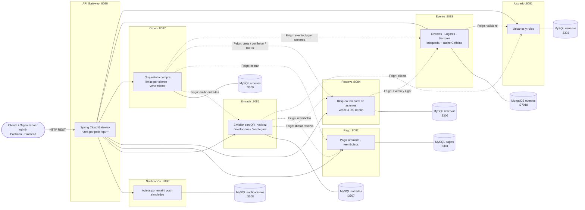
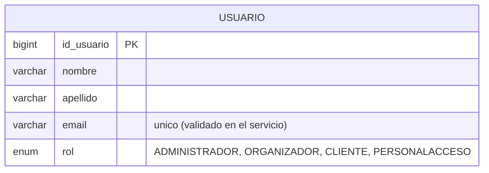
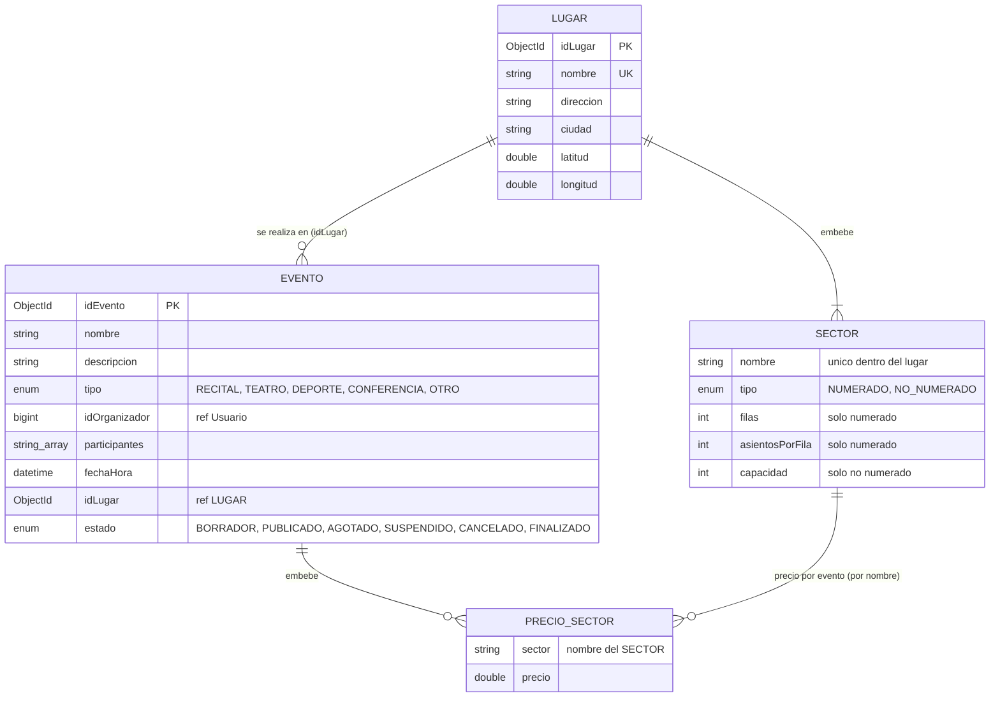
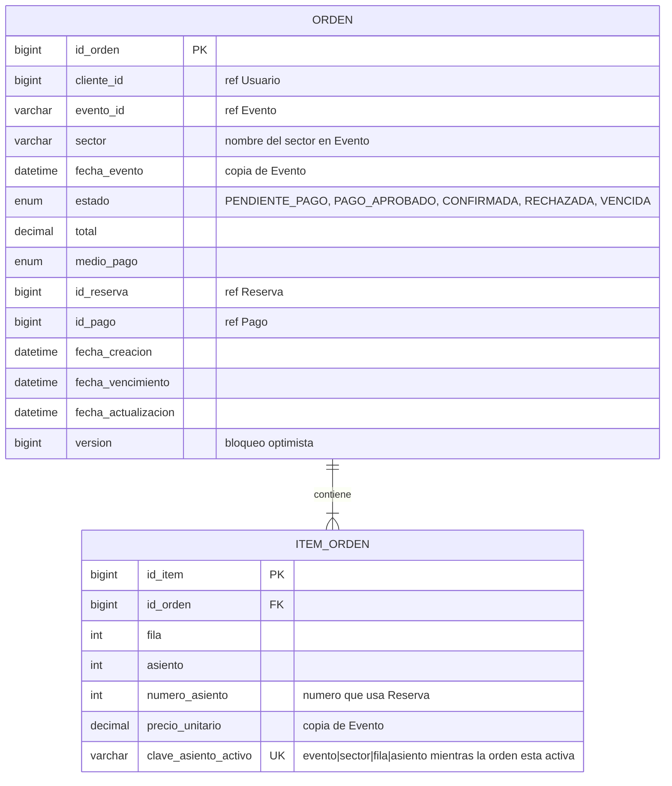
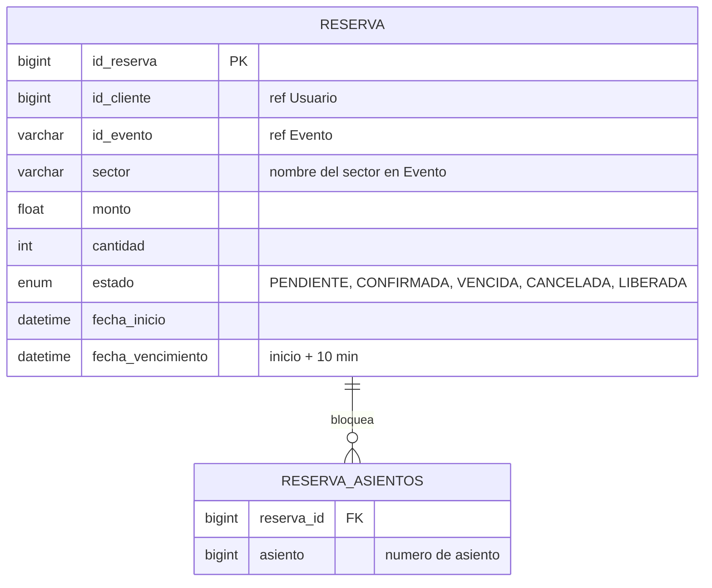
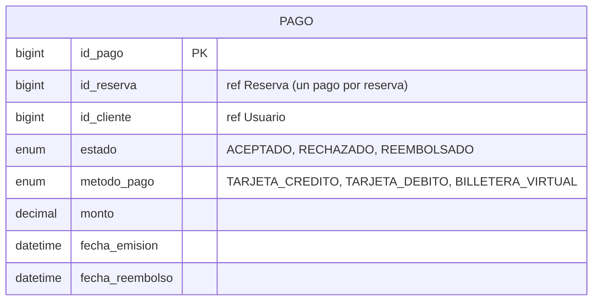
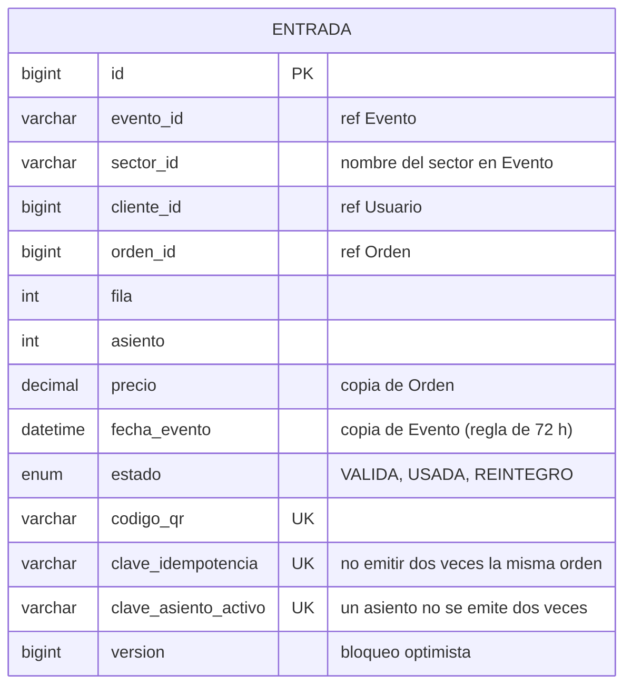
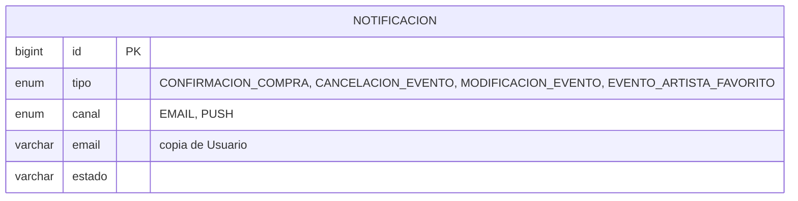
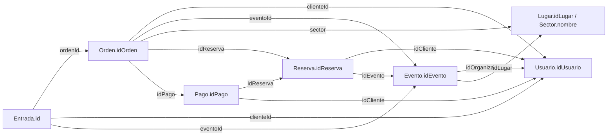

# TicketYa — Diagramas de arquitectura

Los diagramas están en [Mermaid](https://mermaid.js.org/): GitHub los muestra como imagen directamente.
Todo lo de este documento surge del código de la rama `develop` (entidades, clientes Feign y `application.yml` de cada microservicio).

- [1. Diagrama de módulos](#1-diagrama-de-módulos)
- [2. Diagrama de secuencia — compra de una entrada numerada](#2-diagrama-de-secuencia--compra-de-una-entrada-numerada)
- [3. Diagramas entidad-relación por microservicio](#3-diagramas-entidad-relación-por-microservicio)
- [4. Relaciones entre servicios y entidades solapadas](#4-relaciones-entre-servicios-y-entidades-solapadas)

---

## 1. Diagrama de módulos

| Módulo | Responsabilidad | Base | Puerto |
|---|---|---|---|
| Gateway | Punto de entrada único, ruteo a cada servicio (JWT en la Entrega 2) | — | 8080 |
| Usuario | Alta, baja y modificación de usuarios y roles | MySQL `usuarios` | 8081 |
| Evento | Lugares con sectores, eventos y su ciclo de vida, búsqueda por criterios, cache del catálogo | MongoDB `eventos` | 8083 |
| Orden | Orquesta la compra: valida evento y límite, reserva, cobra y emite; vence órdenes impagas | MySQL `ordenes` | 8087 |
| Reserva | Bloquea asientos mientras se paga; vence a los 10 minutos | MySQL `reservas` | 8084 |
| Pago | Pago simulado y reembolsos | MySQL `pagos` | 8082 |
| Entrada | Emite entradas con QR, controla que un asiento no se emita dos veces, devoluciones y reintegros | MySQL `entradas` | 8085 |
| Notificación | Registra y "envía" avisos (simulado) | MySQL `notificaciones` | 8086 |

**Comunicación:** síncrona por REST. Entre servicios se usa OpenFeign (líneas punteadas). Cada microservicio tiene **su propia base** y nadie lee la base de otro: los datos ajenos se piden por API.

**Fila virtual** todavía no está implementada (Entrega 2).

---

## 2. Diagrama de secuencia — compra de una entrada numerada

Incluye los casos de **pago rechazado** y **reserva vencida**. Está en el diseño del flujo de compra:
[`openspec/changes/archive/2026-11-06-orden-flujo-compra/design.md` → sección 11](../openspec/changes/archive/2026-11-06-orden-flujo-compra/design.md#11-diagrama-de-secuencia--compra-de-una-entrada-numerada).

---

## 3. Diagramas entidad-relación por microservicio

`PK` = clave primaria · `UK` = única · `"ref X"` = id de otro microservicio (no hay FK real entre bases).

### Usuario — MySQL `usuarios`

### Evento — MongoDB `eventos`

En Mongo los sectores y los precios van **embebidos** en el documento (no son colecciones aparte).

### Orden — MySQL `ordenes`

### Reserva — MySQL `reservas`

### Pago — MySQL `pagos`

### Entrada — MySQL `entradas`

### Notificación — MySQL `notificaciones`

---

## 4. Relaciones entre servicios y entidades solapadas

No hay claves foráneas entre bases: cada servicio guarda **el id** de la entidad de otro servicio y la consulta por API cuando la necesita.

| Referencia | Guardada en | Apunta a |
|---|---|---|
| id de cliente / organizador | Evento (`idOrganizador`), Orden (`clienteId`), Reserva (`idCliente`), Pago (`idCliente`), Entrada (`clienteId`) | Usuario |
| id de evento | Orden, Reserva, Entrada | Evento (ObjectId de Mongo, por eso es `String`) |
| sector | Orden (`sector`), Reserva (`sector`), Entrada (`sectorId`) | Nombre del sector dentro del Lugar (no tiene id propio) |
| id de reserva | Orden, Pago | Reserva |
| id de pago | Orden | Pago |
| id de orden | Entrada | Orden |

### Entidades solapadas

Hay información que se **repite a propósito** en varias bases para que cada servicio funcione sin consultar a otro en cada operación:

| Dato | Dónde se repite | Fuente de verdad | Por qué |
|---|---|---|---|
| **Asiento ocupado** (evento + sector + fila/asiento) | Reserva (`reserva_asientos`), Orden (`item_orden.clave_asiento_activo`), Entrada (`clave_asiento_activo`) | **Entrada** para lo vendido; Reserva para el bloqueo temporal | Defensa en profundidad contra la doble venta: cada servicio tiene una restricción `UNIQUE` en su base |
| **Precio** | Evento (`PrecioSector`) → Orden (`precio_unitario`, `total`) → Pago (`monto`) → Entrada (`precio`) | Evento al momento de comprar | Se congela el precio pagado aunque el organizador lo cambie después |
| **Fecha del evento** | Evento → Orden (`fecha_evento`) → Entrada (`fecha_evento`) | Evento | Entrada controla la regla de 72 h de devolución sin llamar a Evento |
| **Email del usuario** | Usuario → Notificación (`email`) | Usuario | La notificación queda registrada con el destinatario de ese momento |

**Riesgo del solapamiento:** si un dato cambia en la fuente (por ejemplo, se reprograma la fecha de un evento) las copias quedan desactualizadas. Para la Entrega 2 se propone propagar esos cambios con eventos asíncronos.

**Inconsistencias de nombres a unificar:** el cliente se llama `idCliente` en Reserva y Pago, pero `clienteId` en Orden y Entrada; el sector se llama `sector` en Orden y Reserva, y `sectorId` en Entrada.
