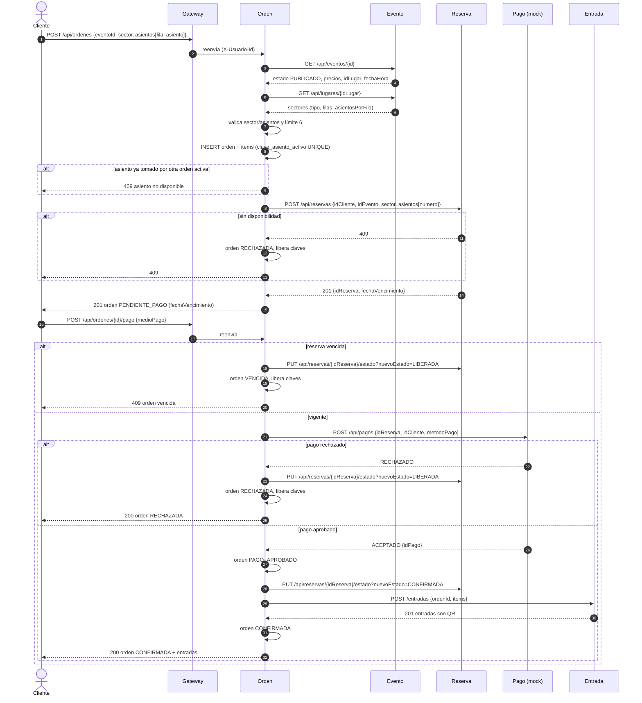

# Design

## Context

Ver `proposal.md` (Why) y `specs/orden/compra-entradas/spec.md` (requisitos).

Todo el circuito se prueba hoy con mocks: los tests de Orden mockean los clientes Feign de Evento, Reserva, Pago y Entrada; Reserva a su vez mockea sus propios clientes a Evento y Usuario (`EventosClientMock`/`UsuarioClientMock`, ver más abajo). Cuando los microservicios reales estén en `develop` y el Gateway los enrute, se configuran las URLs reales en `application.yml`. Hasta entonces, los puntos marcados como "bloquea integración real" abajo no frenan el desarrollo de Orden, solo importan para la prueba end-to-end final.

Estado actual relevante (Reserva y Pago verificados contra el código real de la rama `ms-pago`, commit `9e16c30`, 2026-11-03):

- **Orden** es un esqueleto Spring Boot 3.3.4 / Java 21 con JPA, MySQL, OpenFeign (`@EnableFeignClients` ya activo), validation y springdoc. Su `application.yml` apunta a `localhost:3306` (la base de Reserva) aunque su contenedor `Orden-mysql` publica el `3309`. El `pom.xml` incluye `spring-cloud-starter-gateway-mvc`, que no corresponde.
- **Evento** (rama `ms-evento`, puerto 8083, MongoDB):
  - `GET /api/eventos/{id}` → `{ idEvento: String, estado: BORRADOR|PUBLICADO|AGOTADO|CANCELADO|FINALIZADO, fechaHora, idLugar, precios: [{ sector: String, precio: Double }] }`.
  - `GET /api/lugares/{id}` → `{ sectores: [{ nombre, tipo: NUMERADO|NO_NUMERADO, filas, asientosPorFila, capacidad }] }`. El nombre del sector es único dentro del lugar.
  - No existe estado `SUSPENDIDO`: la regla "solo se vende si está `PUBLICADO`" cubre suspensión y cancelación.
- **Entrada** (rama `entrada-crud`, puerto 8085): `POST /entradas` con `{ ordenId: Long, eventoId, clienteId, fechaEvento, items: [{ sectorId, fila, asiento, precio }] }`, idempotente por `ordenId`; valida además un máximo de 6 por cliente/evento. Hoy usa `Long eventoId` y `Long sectorId`; el grupo acordó pasar a `eventoId: String` y sector por nombre.
- **Reserva** (rama `ms-pago`, puerto 8084):
  - `POST /api/reservas` `{ idCliente: Long, idEvento: String, sector: String, asientos: [Long] }` → `201 { idReserva: Long, idCliente, idEvento, sector, asientos, estado: PENDIENTE|CONFIRMADA|VENCIDA, fechaInicio, fechaVencimiento }` (vence a los 10 minutos). El `EstadoReserva` real solo tiene esos tres valores (no existe `LIBERADA`). Errores actuales: 400 (sector inexistente, asientos inválidos, límite), **500 cuando los asientos están ocupados** (lanza `IllegalStateException`, que el controller no atrapa y cae al catch genérico).
  - `GET /api/reservas/{id}`; `PUT /api/reservas/{id}/estado?nuevoEstado=...` → 200.
  - Valida un límite propio de 20 entradas, valida asientos contra `asientosPermitidos` (campo fijo del sector, no calculado) y cuenta las reservas `VENCIDA` como ocupadas.
  - **Bloquea integración real:** antes de reservar, `ReservaService` también consulta Evento (`EventosClient`) y Usuario (`UsuarioClient`) — pero ambos están mockeados con `@Primary` (`EventosClientMock`, `UsuarioClientMock`): Reserva nunca llama a los servicios reales todavía. El mock de Evento siempre devuelve un sector fijo "Platea VIP" con asientos 100-103, sin importar qué `idEvento`/`sector` se pida. Mientras estos mocks sigan activos, cualquier prueba end-to-end con un evento/sector distinto de ese va a fallar con "sector inexistente", sin relación con el evento real.
- **Pago** (rama `ms-pago`, puerto 8082, mock):
  - `POST /api/pagos` `{ idReserva: Long, idCliente: Long, metodoPago: TARJETA_CREDITO|TARJETA_DEBITO|BILLETERA_VIRTUAL }` → `201 { idPago: Long, idCliente, idReserva, estado: ACEPTADO|PENDIENTE|RECHAZADO, metodoPago, fecha_emision }`. Intenta tomar el monto de la reserva vía `ReservaExternatDTO.montoTotal`, pero `ReservaResponseDTO` no expone ningún campo de monto, así que hoy ese valor siempre llega `null` (detalle menor, no afecta a Orden porque Orden calcula su propio total desde Evento).
  - Hoy además consulta la reserva, valida vencimiento y un límite propio de 5, y confirma la reserva; siempre devuelve `ACEPTADO`; un segundo pago de la misma reserva devuelve 409 "ya pagada". El controller mapea `IllegalArgumentException` (reserva no encontrada, cliente no coincide) a 404, no a 400 como en el resto de sus endpoints — detalle del contrato a tener en cuenta si Orden llega a ver ese código, aunque no debería ocurrir en uso normal (Orden siempre manda un `idReserva` propio recién creado).
- **Decisión del grupo:** **Orden coordina la compra**. Pago solo cobra y Reserva solo reserva; las validaciones de negocio de la compra (límite, vencimiento, confirmación) son de Orden.
- Convenciones del equipo (ms-usuario): paquetes `controller / dto.request / dto.response / entity / mapper / repository / service / exception / utils`, Lombok, mapper manual `@Component`, `GlobalExceptionHandler` con `IllegalArgumentException`→400, `IllegalStateException`→409, `ResponseStatusException`→su código, anotaciones Swagger en el controller.

## Goals / Non-Goals

**Goals:**
- Orquestar Evento → Reserva → Pago → Entrada de forma síncrona con compensación básica (liberar reserva) ante rechazo o vencimiento.
- Garantizar la no doble venta de asientos numerados en Orden con un mecanismo que funcione con varias instancias.
- Hacer el pago idempotente y reanudable desde Orden.
- Adaptarse a los contratos existentes de Reserva y Pago, pidiendo solo los cambios mínimos (ver "Cambios pendientes en otros servicios").

**Non-Goals:**
- Reembolso automático si Entrada falla de forma definitiva tras un pago aprobado (saga completa, Entrega 2). En Entrega 1 la orden queda en `PAGO_APROBADO` y se completa con un reintento.
- Control de capacidad de sectores no numerados (lo hace Reserva).
- Validar que el `X-Usuario-Id` exista en ms-usuario (Reserva ya lo valida al reservar).
- Circuit breaker, reintentos automáticos, cache, log centralizado.

## Decisions

### 1. Flujo en dos pasos: crear orden y pagar orden
`POST /api/ordenes` reserva y deja `PENDIENTE_PAGO`; `POST /api/ordenes/{id}/pago` cobra y cierra.
- **Por qué:** refleja el enunciado ("reserva temporalmente mientras el cliente paga"), hace observable el vencimiento de la reserva y da un recurso estable (la orden) sobre el cual reintentar el pago.
- **Alternativa descartada:** un único `POST` que reserva y paga. Más simple, pero el vencimiento casi nunca ocurre y el reintento necesitaría una clave de idempotencia enviada por el cliente.

### 2. Máquina de estados de la orden

```
PENDIENTE_PAGO ──pago aprobado──▶ PAGO_APROBADO ──entradas emitidas──▶ CONFIRMADA
      │  │
      │  └──pago rechazado──▶ RECHAZADA
      └──vencimiento───────▶ VENCIDA
```

- `PAGO_APROBADO` es transitorio: separa "ya se cobró" de "ya se emitió". Si Entrada falla, la orden queda ahí y un reintento de pago **no vuelve a cobrar**: solo reintenta la emisión.
- Estados activos (ocupan asiento y cuentan para el límite): `PENDIENTE_PAGO`, `PAGO_APROBADO`, `CONFIRMADA`. Terminales que liberan: `RECHAZADA`, `VENCIDA`.

### 3. Modelo de datos (esquema `ordenes`)

**`orden`**
| Campo | Tipo | Notas |
|---|---|---|
| id_orden | BIGINT PK auto | se envía como `ordenId` a Entrada |
| cliente_id | BIGINT | del header `X-Usuario-Id` (referencia lógica a ms-usuario) |
| evento_id | VARCHAR | id de Mongo de ms-evento |
| sector | VARCHAR | nombre del sector (único en el lugar) |
| fecha_evento | DATETIME | snapshot de Evento, necesario para Entrada |
| estado | VARCHAR (enum) | ver máquina de estados |
| total | DECIMAL(12,2) | suma de items |
| medio_pago | VARCHAR (enum) nullable | `TARJETA_CREDITO`, `TARJETA_DEBITO`, `BILLETERA_VIRTUAL` (mismos valores que Pago) |
| id_reserva | BIGINT nullable | devuelto por Reserva |
| id_pago | BIGINT nullable | devuelto por Pago (necesario luego para reintegros) |
| fecha_creacion, fecha_vencimiento, fecha_actualizacion | DATETIME | |
| version | BIGINT | `@Version`, bloqueo optimista |

Índice en `(cliente_id, evento_id, estado)` para el conteo del límite y en `(estado, fecha_vencimiento)` para el job de vencimiento.

**`item_orden`**
| Campo | Tipo | Notas |
|---|---|---|
| id_item | BIGINT PK auto | |
| id_orden | FK → orden | |
| fila, asiento | INT nullable | null en sectores no numerados |
| numero_asiento | INT nullable | número que entiende Reserva (ver decisión 8) |
| precio_unitario | DECIMAL(12,2) | tomado de Evento |
| clave_asiento_activo | VARCHAR **UNIQUE** nullable | `eventoId:sector:fila:asiento` mientras la orden está activa; `NULL` en no numerados o cuando la orden pasa a `RECHAZADA`/`VENCIDA` |

Entidades solapadas con otros servicios (para el DER del TP): `evento_id`/`sector` replican claves de Evento; `cliente_id` de Usuario; `id_reserva` de Reserva; `id_pago` de Pago; Entrada guarda `ordenId` apuntando a `orden.id_orden`.

### 4. No doble venta: restricción única con clave activa
La columna `clave_asiento_activo` UNIQUE hace que la base de datos rechace el segundo insert del mismo asiento, sin importar cuántas instancias de Orden haya. MySQL permite múltiples `NULL` en una columna única, por eso liberar un asiento es poner su clave en `NULL`.
- La creación hace el insert con `saveAndFlush` **antes** de llamar a Reserva: si hay `DataIntegrityViolationException` → 409 sin tocar Reserva. Si luego Reserva rechaza o falla, la orden pasa a `RECHAZADA` con sus claves en `NULL` (queda registrado el intento de compra) y se responde 409 o 503.
- Es la misma técnica que usa Entrada (`clave_asiento_activo`), lo que da coherencia al grupo. Además protege aunque el chequeo de Reserva (consulta + insert) no sea seguro ante concurrencia.
- **Alternativas descartadas:** chequear con un `SELECT` antes de insertar (falla con concurrencia: dos instancias ven "libre" a la vez); `synchronized`/locks en memoria (no sirven con varias instancias); `SELECT ... FOR UPDATE` (requiere una fila previa por asiento que Orden no tiene).

### 5. Idempotencia del pago
- La protección principal está en Orden: `POST /pago` decide según el estado actual y solo llama a Pago desde `PENDIENTE_PAGO`:
  - `RECHAZADA` → devuelve la orden tal cual (200), sin llamadas externas.
  - `CONFIRMADA` → devuelve la orden (200) reconsultando la emisión en Entrada (ver nota abajo), sin llamar a Pago.
  - `VENCIDA` → 409.
  - `PAGO_APROBADO` → solo reintenta la emisión en Entrada.
  - `PENDIENTE_PAGO` → flujo completo.
- **Nota sobre `CONFIRMADA`:** Orden no persiste las entradas emitidas (solo Entrada las guarda, con su QR); el modelo de datos de la decisión 3 no tiene tabla para cachearlas. Por eso, a diferencia de `RECHAZADA`, el reintento sobre una orden `CONFIRMADA` sí vuelve a llamar a `POST /entradas` con el mismo `ordenId` para obtener las mismas entradas a devolver. No es un problema porque esa llamada es idempotente por `ordenId` (decisión 8): Entrada no crea registros nuevos ni cobra de nuevo, solo devuelve lo ya emitido. El efecto observable sigue siendo "sin nuevo cobro ni nueva emisión", aunque Orden sí hace esa única llamada de lectura.
- Hacia Pago, el `idReserva` actúa como clave de idempotencia (Pago no admite dos pagos de la misma reserva).
- Caso borde: Pago cobró pero la respuesta no llegó (timeout) y el cliente reintenta. Hoy Pago respondería 409 "ya pagada" sin datos del pago; Orden lo trata como **resultado incierto**: no vuelve a cobrar, la orden sigue `PENDIENTE_PAGO` y responde 503. Queda resuelto cuando Pago devuelva el pago existente (ver pendientes).
- Dos pagos simultáneos de la misma orden: `@Version` hace que uno falle con `OptimisticLockingFailureException`; ese request relee la orden y devuelve su estado actual.

### 6. Límite de 6 entradas
Antes de reservar: `SUM(items)` de órdenes del cliente para el evento en estados activos + cantidad pedida > 6 → 422 (mismo código que usa Entrada). Valor configurable en `application.yml` (`orden.limite-entradas-por-evento: 6`). Orden es el dueño de esta regla; Entrada la repite como segunda barrera.

### 7. Vencimiento
- `fecha_vencimiento` = `fechaVencimiento` que devuelve Reserva (fallback configurable `orden.minutos-reserva: 10`).
- Al pagar se compara con `now()`; si venció → `VENCIDA`, liberar reserva, 409, sin llamar a Pago.
- Job `@Scheduled` (cada 30 s, configurable) que toma órdenes `PENDIENTE_PAGO` vencidas, las pasa a `VENCIDA`, pone `clave_asiento_activo` en `NULL` y pide liberar la reserva. Con varias instancias el `@Version` evita dobles transiciones; liberar una reserva ya liberada no debe fallar.
- **Por qué el job:** sin él, un cliente que abandona deja los asientos bloqueados en Orden para siempre (la clave única nunca se libera).

### 8. Contratos externos (Feign)
URLs base en `application.yml` (`servicios.evento.url`, `servicios.reserva.url`, `servicios.pago.url`, `servicios.entrada.url`) para poder cambiarlas sin tocar código.

**Evento (existente):** `GET /api/eventos/{id}`, `GET /api/lugares/{idLugar}`. 404 → 404 de Orden.

**Reserva (existente):**
- Crear: `POST /api/reservas`
  ```json
  { "idCliente": 7, "idEvento": "6720f1a3...", "sector": "Platea", "asientos": [45, 46] }
  ```
  → `201 { "idReserva": 31, "estado": "PENDIENTE", "fechaVencimiento": "2026-11-04T18:40:00", ... }`.
- Confirmar (tras pago aprobado): `PUT /api/reservas/{idReserva}/estado?nuevoEstado=CONFIRMADA`.
- Liberar (pago rechazado o vencimiento): `PUT /api/reservas/{idReserva}/estado?nuevoEstado=LIBERADA`.
- **Número de asiento:** Orden recibe fila y asiento del cliente y envía a Reserva `numero = (fila - 1) × asientosPorFila + asiento` (con `asientosPorFila` del Lugar en Evento). Ej.: 20 asientos por fila → fila 3, asiento 5 = 45. Así Orden y Entrada trabajan con fila/asiento y Reserva con su número, sin cambiar su contrato. La numeración es **por sector** (se descartó una numeración global por evento con desplazamientos por sector, frágil ante cambios en los sectores), por lo que Reserva debe incluir el sector al chequear ocupación (decisión 9).

**Pago (existente, mock):** `POST /api/pagos`
```json
{ "idReserva": 31, "idCliente": 7, "metodoPago": "TARJETA_CREDITO" }
```
→ `201 { "idPago": 12, "estado": "ACEPTADO" | "RECHAZADO", ... }`. `ACEPTADO` → aprobado; `RECHAZADO` → rechazado; `PENDIENTE` se trata como resultado incierto (503, la orden sigue pendiente).

**Entrada (existente, con el ajuste acordado):** `POST {entrada.url}/entradas` con
```json
{ "ordenId": 15, "eventoId": "6720f1a3...", "clienteId": 7, "fechaEvento": "2026-12-10T21:00:00",
  "items": [ { "sector": "Platea", "fila": 3, "asiento": 5, "precio": 15000 } ] }
```
→ `201 [ { id, codigoQr, fila, asiento, ... } ]`.

**Manejo de errores remotos:** un `ErrorDecoder` traduce 404/409 de los otros servicios a excepciones de negocio de Orden; errores de conexión o 5xx → 503 (`ServicioNoDisponibleException`). Timeouts de Feign configurados (connect 2 s, read 5 s) para no colgar el request. Mientras Reserva responda 500 para "asientos ocupados", ese caso llega a Orden como 503 (ver pendientes).

### 9. Cambios pendientes en otros servicios
Para que la integración real funcione con Orden como coordinador, se piden estos cambios mínimos (los tests de Orden los simulan, así que no bloquean la implementación):

| Servicio | Cambio | Por qué |
|---|---|---|
| Pago | Dejar de validar límite y vencimiento y de confirmar la reserva | Lo hace Orden (decisión del grupo); hoy su límite de 5 rechazaría compras válidas |
| Pago | Si llega un pago de una reserva ya pagada, devolver ese pago (200) en vez de 409 | Reintento idempotente tras un timeout (decisión 5) |
| Pago | Que el mock rechace algunos casos (ej. ciertos `idCliente`) | Poder probar el pago rechazado |
| Reserva | Responder 409 cuando los asientos están ocupados (hoy 500) | Cosmético: distingue "sin lugar" de "servicio caído"; Orden ya tolera el 500 actual tratándolo como 503 |
| Reserva | **[Bloquea integración real]** Agregar estado `LIBERADA`, que no cuente como ocupado; y no contar `VENCIDA` como ocupada | Hoy un asiento liberado queda bloqueado para siempre (el enum `EstadoReserva` solo tiene PENDIENTE/CONFIRMADA/VENCIDA) |
| Reserva | **[Bloquea integración real]** Dejar de usar `EventosClientMock` y `UsuarioClientMock` (ambos `@Primary`; el de Evento fija el sector "Platea VIP" con asientos 100–103) y consumir Evento y Usuario reales | Hoy Reserva nunca consulta Evento ni Usuario; con datos de un evento real sus validaciones siempre fallan |
| Reserva | **[Bloquea integración real]** Agregar `tipo`, `filas`, `asientosPorFila` y `capacidad` a `SectorExternoDTO` y validar el número de asiento contra `filas` × `asientosPorFila` (fórmula de la decisión 8), no contra `asientosPermitidos`; tomar el precio de `precios` del Evento | `SectorExternoDTO` hoy solo tiene `nombre`, `precio`, `asientosPermitidos`; no alcanza para validar contra un lugar real |
| Reserva | Exponer el monto/total en `GET /api/reservas/{id}` | Pago espera `montoTotal` en la respuesta y hoy no existe, así que el monto que guarda Pago siempre es `null` (no afecta a Orden) |
| Reserva | Incluir el **sector** en el chequeo de asientos ocupados (`contarAsientosOcupados` hoy filtra solo por evento y número) | El número de asiento es por sector: sin esto, el asiento 45 de Platea bloquea el 45 de otro sector |
| Reserva | Aceptar `cantidad` (sin asientos) para sectores no numerados y controlar su capacidad | Los no numerados no tienen asientos y hoy la lista es obligatoria |
| Reserva | Quitar su límite de 20 | El límite es de Orden |
| Entrada | `eventoId` String y sector por nombre | Acuerdo de IDs del grupo |

### 10. API expuesta
| Método | Ruta | Éxito | Errores |
|---|---|---|---|
| POST | `/api/ordenes` | 201 orden | 400, 404, 409 (evento no publicado / asiento ocupado), 422 límite, 503 |
| POST | `/api/ordenes/{id}/pago` | 200 orden (`CONFIRMADA` o `RECHAZADA`, con entradas si confirmada) | 400, 403, 404, 409 vencida, 503 |
| GET | `/api/ordenes/{id}` | 200 orden | 403, 404 |
| GET | `/api/ordenes?eventoId=` | 200 lista de órdenes del cliente | 400 |

Todos requieren `X-Usuario-Id` (falta → 400). Excepciones de negocio propias (`EventoNoDisponibleException`, `AsientoNoDisponibleException`, `LimiteEntradasExcedidoException`, `OrdenVencidaException`, `ServicioNoDisponibleException`, `AccesoDenegadoException`) se agregan al `GlobalExceptionHandler` con el mismo formato de cuerpo que ms-usuario.

<a id="diagrama-de-secuencia"></a>
### 11. Diagrama de secuencia — compra de una entrada numerada



### 12. Testing
- **Unitarias** (JUnit 5 + Mockito, clientes Feign mockeados): creación válida, evento inexistente/no publicado, sector inválido, límite, conversión fila/asiento → número, pago aprobado, rechazado, vencido, reintento por cada estado, 409 "ya pagada" como resultado incierto, fallo de Entrada tras pago aprobado.
- **Controller** (`@WebMvcTest`, servicio mockeado): códigos HTTP y header obligatorio. No usan base de datos.
- **Repositorio y concurrencia contra el MySQL dockerizado real** (contenedor `Orden-mysql`, puerto 3309), en un esquema separado `ordenes_test` (`createDatabaseIfNotExist=true`, `ddl-auto: create-drop`) definido en `src/test/resources/application.yml`, para no ensuciar los datos de desarrollo. `@DataJpaTest` lleva `@AutoConfigureTestDatabase(replace = NONE)` para no reemplazar MySQL por una base embebida.
- **Concurrencia** (`@SpringBootTest`, Reserva mockeada siempre OK): N hilos (ej. 50) crean la orden del mismo asiento con un `CountDownLatch` de largada; se verifica que exactamente 1 queda activa y N-1 reciben conflicto. Prueba el mecanismo de la restricción única sobre el mismo motor que usa el sistema.
- **Por qué MySQL real y no H2:** la no doble venta depende de cómo el motor aplica la restricción única y trata los `NULL`; probarlo sobre una emulación debilitaría la evidencia. **Contra:** los tests que tocan la base requieren `Orden-mysql` levantado (`docker compose up -d` en `Orden/`); los unitarios con Mockito no. Testcontainers queda como mejora para Entrega 2.

## Risks / Trade-offs

- [Los cambios pendientes en Pago, Reserva y Entrada (decisión 9) no se apliquen a tiempo] → Orden se implementa y prueba con mocks de esos contratos; la integración real de punta a punta queda bloqueada en el punto afectado (p. ej. con el límite de 5 de Pago, compras de 6 entradas fallarían).
- [Pago aprobado y Entrada caída de forma persistente deja la orden en `PAGO_APROBADO` con dinero cobrado] → En Entrega 1 se resuelve con reintento manual del pago; el reembolso automático (compensación completa) queda para la saga de Entrega 2.
- [Mientras Pago responda 409 "ya pagada", un pago cobrado cuya respuesta se perdió deja la orden en `PENDIENTE_PAGO`] → Orden no vuelve a cobrar (no hay doble cobro); se resuelve cuando Pago devuelva el pago existente.
- [La fórmula del número de asiento debe ser la misma en Orden y Reserva] → Documentada en este design y en el README; cubierta por test unitario en Orden.
- [Conteo del límite con dos órdenes simultáneas del mismo cliente puede dejar pasar más de 6] → Caso raro (mismo cliente, mismo evento, mismo instante). Entrada vuelve a validar el límite al emitir como segunda barrera.
- [El job de vencimiento corre en todas las instancias] → Transiciones protegidas por `@Version`; liberar una reserva ya liberada no debe fallar. Se podría usar un lock distribuido (ShedLock) más adelante.
- [Desfase entre el `fechaVencimiento` de Reserva y el reloj de Orden] → Se usa el valor informado por Reserva; diferencias de segundos son aceptables en Entrega 1.
- [Precios en `Double`/`Float` en Evento y Pago] → Orden trabaja montos en `BigDecimal` con 2 decimales.

## Migration Plan

No hay datos previos: el esquema se crea con `ddl-auto` (create-drop en desarrollo, como el resto del equipo). Despliegue: levantar `Orden-mysql` con el `docker-compose.yml` de Orden (puerto 3309) y luego la aplicación en el 8087. Rollback: revertir el merge de la rama `ms-orden`.
